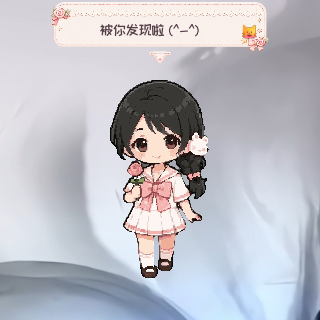
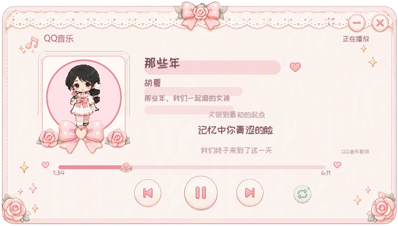
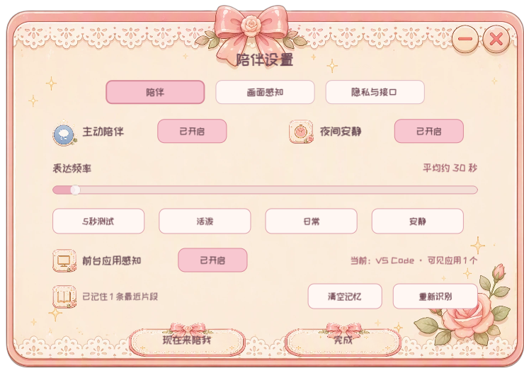
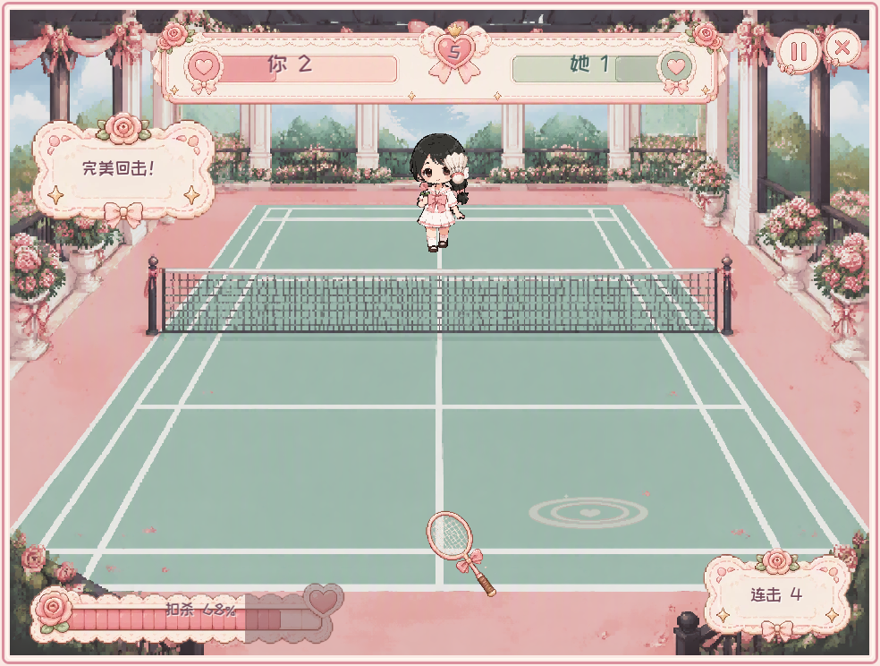

# qianqian DesktopPet

> 会在桌面上生活、聊天、听歌，也会陪你休息和玩游戏的少女桌宠。

[](https://godotengine.org/)
[](#快速开始)
[](https://docs.godotengine.org/)
[](#当前状态)
[](#项目与素材声明)

## 项目简介

qianqian DesktopPet 是一款使用 **Godot 4** 开发的 Windows 少女桌宠。它不只是播放固定动画，而是把桌面角色、养成状态、AI 对话、主动陪伴、前台应用感知、可选的画面理解、音乐联动、小游戏和小狗伙伴组合成一个持续存在于电脑桌面的陪伴系统。桌宠女孩叫 **qianqian**，白色小狗伙伴叫 **小雪球**；两者是独立角色，请勿混淆。

项目希望解决传统桌宠“只能看、不能相处”的单调感：qianqian 会自己散步和休息，记住最近的互动，在你工作、听歌或玩游戏时给出符合情境的回应，也允许用户决定 AI 接口、表达频率、感知范围和每日视觉额度。

> 当前为个人学习与作品开发项目，仓库保持私有。`0.1.0` 已具备完整可运行主流程，沉浸音乐全屏仍在持续打磨。

## 动图预览

<p align="center">
  
</p>

<p align="center">qianqian 的真实待机动画，由项目内 SpriteFrames 导出。</p>

## 截图预览

| 桌面互动 | 音乐中心 |
| --- | --- |
|  |  |

| 陪伴与隐私设置 | 羽毛球小游戏 |
| --- | --- |
|  |  |

## 功能总览

- 桌面角色：透明窗口、像素级点击区域、八方向散步、拖拽摇晃、睡觉翻身和随机待机活动。
- 情绪表达：紧凑气泡、自动换行、中文与颜文字、点击回应、主动说话和情境化台词。
- 日常养成：饱腹、水分、心情、好感、精力五项状态，以及吃饭、喝水、娱乐、送礼、摸摸和休息。
- AI 对话：OpenAI 兼容接口、多服务商预设、本地聊天记录、拟人化错误提示和养成联动。
- 主动陪伴：可调表达频率、短期陪伴记忆、前台应用语境、音乐语境、安静时段和本地兜底台词。
- 画面感知：明确授权后进行本地变化筛选，再按用户配置调用视觉模型，可设额度或不限量。
- 音乐陪伴：读取 Windows 媒体会话，展示封面、歌曲、歌手、歌词和进度，并控制本地播放器。
- 羽毛球对战：鼠标控制球拍、回球判定、连击、蓄力扣杀、难度选择、计分、结算、音乐和音效。
- 小狗伙伴：领养、命名、回窝、八方向移动、坐下、睡觉、开心、照料和与 qianqian 的主动互动。
- 隐藏彩蛋：通过设置页中的隐藏操作触发 qianqian 骑龙飞过桌面。
- 活动日志：记录 AI 请求、陪伴决策和感知流程，自动脱敏并按周期清理。

## 功能详解

### 1. 桌面移动与窗口交互

- qianqian 运行在无边框、透明、置顶的原生 Windows 窗口中，不显示普通应用的矩形背景。
- 点击区域会根据当前动画帧的 Alpha 透明度动态更新；人物以外的大部分透明区域可穿透到后方软件。
- 支持八方向行走：上、下、左、右以及四个斜向，行走动画与真实窗口移动方向同步。
- 自动散步会在待机与移动之间随机切换，碰到当前显示器工作区边缘会调整方向，不会走出屏幕。
- 左键按住角色可拖动桌宠；拖动时角色会随鼠标方向产生摆动，松手后平滑恢复。
- 右键菜单会贴近角色不透明边界打开，并在靠近屏幕边缘时自动换到另一侧。
- 可通过右键菜单开关自动散步、让她回到屏幕中央、主动睡觉、打开各功能窗口或退出程序。

### 2. 动画、休息与随机行为

- 基础动作包含待机、八方向行走、入睡、睡眠待机、醒来和睡觉翻身。
- 睡眠翻身会正向播放、在尾帧短暂停留，再倒放回原姿势，之后继续睡眠或自然醒来。
- 睡觉时恢复精力，并暂停普通随机气泡，避免角色一边熟睡一边说话。
- qianqian 在普通待机期间有小概率自行进入听歌、掌机游戏或羽毛球练习等活动。
- 听歌、掌机和羽毛球动作都有独立播放时长与速度，结束后回到正常状态机。
- 隐藏骑龙彩蛋拥有触发对白、起飞等待、横向飞行、上下浮动和结束恢复流程。

### 3. 气泡、颜文字与反馈

- 点击 qianqian、养成操作、AI 回复、主动陪伴、音乐事件和小狗互动都可以触发角色气泡。
- 气泡使用独立少女风格素材，尖角位于头部上方，尽量不遮挡人物头发。
- 中文文本按真实字体宽度换行，长句会缩小字号并在安全区域内省略，避免越出装饰边框。
- 支持 emoji 与颜文字；主动陪伴会按概率自然加入颜文字，而不是每句话机械堆叠。
- 气泡出现与消失带淡入淡出效果，显示期间也会同步更新窗口鼠标区域。
- 养成操作会额外显示饱腹、水分、心情、好感或精力的短暂视觉反馈。

### 4. 日常养成系统

养成系统维护五项持续状态：

- `饱腹`：会随时间下降，过低时继续影响心情。
- `水分`：下降速度高于饱腹，严重缺水会额外影响心情。
- `心情`：由陪伴、娱乐、礼物、小游戏和身体状态共同影响。
- `好感`：通过聊天、摸摸、礼物、共同活动和小游戏结果积累。
- `精力`：清醒时缓慢下降，睡觉时持续恢复；过低时会拒绝高消耗娱乐。

“她的日常”窗口提供以下互动：

- 吃饭：樱桃布丁、草莓蛋糕、爱心三明治、爱心饭团、蛋包饭。
- 喝水：珍珠奶茶、草莓牛奶、鲜橙果汁、矿泉水、热可可。
- 娱乐：玩偶时间、一起听歌、掌机对战、一起画画、故事时间、羽毛球。
- 礼物：玫瑰花束、星星挂饰、蝴蝶结礼盒、爱心发饰、手写信。
- 快捷互动：聊天、摸摸和休息。

状态会定时保存到本机，并计算最多 8 小时的离线变化；重新启动程序后不会全部重置。吃得过饱、暂时不渴或精力不足时，qianqian 会用自然台词拒绝不合适的操作。

### 5. AI 聊天

- 聊天窗口可从日常界面或“和她说说话”入口打开，支持连续多轮对话。
- 内置 OpenAI、DeepSeek、GLM、硅基流动和自定义 OpenAI 兼容接口预设。
- 用户可以配置接口地址、模型名称、API Key，以及是否在本机记住 Key。
- 最多保留 30 条本地聊天历史，每次请求携带最近 14 条，以兼顾上下文与请求成本。
- 设置页支持一键清空聊天记录；聊天列表和侧边爱心位置会随滚动同步。
- 回复提示词会包含 qianqian 当前养成状态，让回答与她的饱腹、心情和精力产生联系。
- 成功聊天会增加少量心情和好感；回复也会同步显示为桌宠气泡。
- 401、403、404、429、服务端异常和网络中断会转换成 qianqian 的口吻，不直接暴露生硬报错。

> AI 服务由用户自行选择和配置。项目不内置公共 API Key，也不会把 Key 提交到 GitHub。

### 6. 主动陪伴

主动陪伴不是固定时间随机抽一句话，而是一个会读取本地状态并决定“现在是否适合说话”的轻量系统：

- 表达频率支持从约 5 秒测试档到 10 分钟安静档，既方便调试，也照顾喜欢高频或低频陪伴的用户。
- 可单独开关主动陪伴、前台应用感知和夜间安静模式。
- 上下文包含养成状态、最近互动、qianqian 当前动作、小狗状态、前台应用和当前音乐。
- 近期说过的句子会参与去重，减少短时间内反复说同一句话。
- AI 暂时不可用时可以使用本地情境台词，不会因为接口波动让桌宠完全沉默。
- 接口限流或失败后会自动退避，避免连续请求浪费额度。
- 小狗回窝后会过滤与小狗有关的主动话题，避免出现角色状态不一致。
- 陪伴记忆可在设置中查看数量、清空，并支持“现在来陪我”立即触发一次思考。

### 7. 前台应用与画面感知

前台应用感知与画面感知是两层能力：前者只读取应用类别，后者才会在授权后处理屏幕图片。

前台应用感知：

- 定时识别用户当前主要使用的软件，并忽略 DesktopPet 和 Godot 自身进程。
- 已覆盖 WPS/Office、主流浏览器、VS Code/Cursor/JetBrains、AI 助手、聊天软件、音乐和视频软件、Steam 等常见类别。
- 主动陪伴可根据“工作学习、浏览网页、编程创作、交流、听歌或准备游戏”等情境组织台词。
- 未识别软件只作为普通应用处理，不读取文档正文、聊天内容或账号信息。

可选画面感知：

- 默认关闭，必须由用户在“陪伴设置 > 画面感知”中明确开启。
- 提供自动、游戏、工作和通用四种分析模式，也支持“立即看看”手动测试。
- 平时只在本机将画面缩成低分辨率采样并计算变化；只有变化达到阈值并稳定后才请求视觉模型。
- 每次分析采集 3 个短间隔关键帧，最长边压缩到 1120 像素并使用 JPEG 压缩，减少传输量与费用。
- 自动请求有冷却时间和定时观察间隔，避免屏幕持续变化时高频调用接口。
- 每日额度由用户自由填写，`0` 表示不设上限；界面同时显示今日已用次数。
- 支持进程/窗口隐私名单，默认包含常见密码管理器、验证器和银行相关关键词。
- 可以沿用聊天接口，也可单独配置视觉接口、视觉模型与独立 API Key。
- 视觉结果先进行置信度、重要性、敏感场景和重复内容判断，再决定是否让 qianqian 开口。
- 截图只在内存中压缩和发送，不保存为本地图片；短期画面记忆可由用户手动清空。

> 画面感知需要真正支持图片输入的多模态模型。仅支持文字的 DeepSeek Chat 等模型不能直接识别屏幕图片。

### 8. 音乐播放器联动与听歌陪伴

- 通过 Windows Global System Media Transport Controls 读取系统当前媒体会话。
- 可联动 QQ 音乐、网易云音乐及其他正确注册系统媒体会话的播放器，不要求读取其私有数据库。
- 展示歌曲标题、歌手、专辑、播放来源、封面、当前时间和总时长。
- 支持播放/暂停、上一首、下一首、拖动进度，以及顺序、列表循环、单曲循环和随机模式请求。
- 播放按钮会根据媒体状态在播放与暂停图标之间切换，歌词切换和封面加载均带过渡动画。
- 歌词服务根据歌曲与歌手搜索 QQ 音乐公开歌词接口，解析 LRC 时间轴并跟随系统播放进度滚动。
- 歌曲信息服务会尝试从中文维基百科获取公开简介，并对同一歌曲结果进行内存缓存。
- 检测到开始播放、暂停或切歌时，qianqian 会切换听歌动作并给出相应反馈。
- 主动音乐陪伴可结合歌曲名、歌手、当前歌词和公开歌曲介绍生成听歌感受，而不只说固定台词。
- 普通音乐窗口支持拖动、最小化和关闭；沉浸音乐模式提供更大的封面、歌词和桌宠活动区域。

> 当前音乐能力是“控制与展示本地播放器”，尚未直接接入 QQ 音乐或网易云的完整曲库、账号和在线播放协议。沉浸全屏界面的输入与视觉仍在重点优化。

### 9. 桌面羽毛球小游戏

- 从日常娱乐中的“羽毛球”进入，拥有独立少女风格球场、边框、HUD、结算页和背景音乐。
- 支持多个难度档，不同难度会改变 qianqian 的移动速度、回球概率、落点范围和球速。
- 玩家使用鼠标移动球拍，也可以在球靠近时点击挥拍。
- 回球质量由击球距离、时机和鼠标挥动速度共同计算；高质量回球会触发“完美回击”。
- 连续回球会累计连击与扣杀能量，蓄满后可以打出更快、更难接的扣杀。
- qianqian 会在远端移动接球并播放专用挥拍动画，双方失误后自动计分并进入下一球。
- 先达到目标分数的一方获胜；结束后可查看胜负与最佳回合，并选择再来一局或退出。
- 包含发球、普通击球、扣杀、完美回击、双方得分、胜利、失败和 UI 确认音效。
- 比赛结果与最佳回合会转化为心情和好感奖励，也会进入主动陪伴记忆。

### 10. 小狗伙伴系统

- 首次使用需要在小狗小屋中完成领养，并给小狗输入名称；默认角色设定为白色线条风格小狗“小雪球”。
- 名称支持后续修改，右键菜单和小屋标题会同步显示当前名字。
- 小狗拥有自己的透明窗口和点击区域，可在桌面独立移动而不与 qianqian 共用一张贴图。
- 动画状态包含待机、八方向行走、坐下过渡、坐下待机、睡觉过渡、睡觉待机和开心。
- 小狗会在 qianqian 附近自由活动，距离过远时自动跟随，也会随机坐下或睡觉。
- 小屋中可以喂点心、喝水、玩球和休息；操作后会触发对应动作与角色台词。
- 可让小狗回窝暂时隐藏，也可以再次叫出来；领养状态、名称和在家状态都会本地保存。
- qianqian 与小狗会按概率主动靠近并播放共同互动动画，不必每次都由用户右键触发。
- 小狗相关事件会进入 qianqian 的主动陪伴上下文，使对话能够提到刚刚发生的互动。

### 11. 少女风格 UI 与窗口体验

- 日常、聊天、陪伴设置、小狗小屋、音乐和羽毛球窗口使用各自匹配的生成式美术素材。
- 功能窗口支持拖动，并尽量保持在当前屏幕可用工作区内。
- 按钮提供悬停、按下或轻摆反馈；状态条与歌词使用 Tween 平滑过渡。
- 项目使用 `ZCOOLKuaiLe` 中文字体，并为系统中文与 emoji 字形提供回退方案。
- 透明子窗口会在重新打开时恢复不透明内容和鼠标输入区域，避免“只剩透明空窗”的状态。
- 任务栏和发布包使用 qianqian 的自定义应用图标，而不是 Godot 默认图标。

### 12. 本地记录与故障排查

- AI 思考、主动陪伴、音乐事件、画面感知、养成与小狗事件会写入按日期分割的 JSONL 日志。
- 日志位于 Godot 的 `user://pet_activity_logs`，默认保留 14 天，每 10 分钟检查并清理过期文件。
- 日志内容会限制长度，并自动隐藏字段名中包含 Key、Token、Secret、Password、Authorization 等敏感数据。
- 聊天历史、陪伴记忆、养成状态、小狗状态和视觉设置分别保存，方便单独清理而不影响其他功能。
- 详细的问题背景、修复原因和验证方式持续记录在 [开发日志](DEVELOPMENT_LOG.md) 中。

## 使用入口

在 qianqian 身上点击鼠标右键，可以看到主要入口：

- `打开她的日常`：养成状态、食物、饮料、娱乐、礼物、聊天、摸摸与休息。
- `音乐中心`：本地播放器状态、封面、歌词、进度和播放控制。
- `小狗的小屋`：未领养时进入领养流程，领养后显示小狗名字和照料功能。
- `让小狗回窝 / 叫小狗出来`：控制小狗是否在桌面活动。
- `和她说说话`：打开 AI 聊天窗口。
- `自动散步`：开关 qianqian 的桌面自动移动。
- `主动陪伴`：快速开关 AI 主动表达。
- `陪伴设置`：调整表达频率、前台应用、画面感知、隐私名单、额度和视觉接口。
- `回到屏幕中央`：将 qianqian 移回当前显示器中央。
- `让她睡觉`：立即进入睡眠流程。
- `退出桌宠`：保存状态并退出程序。

## 快速开始

### 使用 Windows 发行包

1. 从仓库的 [Releases](../../releases) 下载安装版 `DesktopPet-0.1.0-Setup.exe` 或便携版 `DesktopPet-0.1.0-Portable.zip`。
2. 安装或解压后运行 `DesktopPet.exe`。
3. 在 qianqian 身上右键打开功能菜单。
4. 需要 AI 功能时，在聊天设置或陪伴设置中填写自己的接口信息。
5. 需要音乐联动时，先在 QQ 音乐、网易云音乐或其他播放器中开始播放歌曲。

### 从源码运行

环境要求：

- Windows 10 或 Windows 11。
- Godot `4.7.1`，项目使用 GL Compatibility 渲染器。
- 可选：QQ 音乐、网易云音乐或其他支持 Windows 系统媒体会话的播放器。
- 可选：OpenAI 兼容聊天接口，以及支持图片输入的视觉模型接口。

运行步骤：

```powershell
git clone https://github.com/Start66613/DesktopPet.git
cd DesktopPet
godot --path .
```

也可以在 Godot 编辑器中导入 `project.godot`，然后运行主场景 `scenes/pet.tscn`。

新增或替换 PNG 动画帧后，可先触发资源导入：

```powershell
godot --headless --import --path .
```

### AI 接口配置

聊天接口需要填写：

- 接口地址：OpenAI 兼容的 `/chat/completions` 地址。
- 模型名称：必须与服务商控制台提供的模型 ID 完全一致。
- API Key：仅保存在本机配置中，也可以关闭“记住 Key”。

画面感知可以沿用聊天接口，也可以在“陪伴设置 > 隐私与接口”中启用独立视觉接口。文字模型无法处理截图时，应选择服务商明确标注支持图片输入的模型。

## 构建 Windows 发布包

Windows 自动构建脚本位于 [`tools/build_windows_release.ps1`](tools/build_windows_release.ps1)：

```powershell
powershell -ExecutionPolicy Bypass -File tools/build_windows_release.ps1
```

构建产物：

- `dist/DesktopPet-0.1.0-Setup.exe`：Inno Setup 安装版。
- `dist/DesktopPet-0.1.0-Portable.zip`：免安装便携版。

`build/`、`dist/`、`.godot/`、`.env`、本地日志和临时备份均已由 `.gitignore` 排除。

## 项目结构

```text
DesktopPet/
├─ assets/                     # qianqian、移动、睡觉、UI、音乐、小狗和小游戏素材
├─ docs/                       # 截图、素材目录、Meowa 生成提示词和功能文档
├─ release/                    # Windows 图标、安装器配置和发行说明
├─ scenes/pet.tscn             # 主场景
├─ scripts/pet.gd              # qianqian 状态机、窗口行为和模块协调
├─ scripts/care_system.gd      # 养成数值、离线变化和存档
├─ scripts/ai_chat_panel.gd    # AI 聊天窗口与接口配置
├─ scripts/proactive_companion.gd
│                              # 主动陪伴、记忆、上下文和表达策略
├─ scripts/screen_awareness_service.gd
│                              # 屏幕变化筛选、截图请求和隐私策略
├─ scripts/music_*.gd          # Windows 媒体会话、歌词、歌曲信息和播放器 UI
├─ scripts/badminton_game_panel.gd
│                              # 羽毛球对战逻辑、HUD、音效与结算
├─ scripts/dog_*.gd            # 小狗状态机、小屋、领养和互动
├─ scripts/pet_activity_logger.gd
│                              # 本地活动日志、脱敏和定期清理
└─ tools/                      # QA、素材处理、原生桥接和 Windows 构建脚本
```

美术素材的来源、运行时文件与备用资源分类见 [素材目录](docs/ASSET_CATALOG.md)。

## 本地数据

程序数据保存在 Godot 的 `user://` 目录中，主要包括：

- `care_state.cfg`：养成数值与最后保存时间。
- `ai_chat.cfg`：聊天服务商、接口、模型和可选的本机 Key。
- `ai_chat_history.json`：聊天历史。
- `companion_settings.cfg`：主动陪伴、表达频率和画面感知设置。
- `companion_memory.json`：近期陪伴记忆。
- `screen_vision.cfg`：独立视觉接口设置。
- `dog_companion.cfg`：小狗领养、名称和回窝状态。
- `pet_activity_logs/*.jsonl`：自动脱敏的活动日志。

这些文件不会被提交到仓库。卸载或清理前可按需备份。

## 技术实现

- 引擎与脚本：Godot `4.7.1`、GDScript。
- 渲染：OpenGL 3.3 / GL Compatibility，像素动画默认最近邻采样。
- 动画：`AnimatedSprite2D`、`SpriteFrames`，运行时整合多套 Godot 资源包。
- 桌面窗口：透明无边框 Window、Windows 工作区定位、动态鼠标穿透多边形。
- AI：OpenAI 兼容 Chat Completions HTTP 请求。
- 屏幕理解：本地低分辨率变化检测、内存关键帧压缩、多模态请求、短期上下文记忆。
- 音乐：Windows Global System Media Transport Controls 原生桥接、QQ 音乐 LRC 解析。
- 持久化：Godot `ConfigFile`、JSON 和按日 JSONL 日志。
- Windows 发布：Godot Export、PowerShell、Inno Setup。
- 美术与音频：用户原创/定制素材与 Meowa 辅助生成资源。

## 隐私与安全

- AI 聊天、前台应用感知和屏幕感知都可以独立开关。
- 屏幕感知默认关闭，启用前必须由用户明确授权。
- 未开启画面感知时，主动陪伴只使用养成状态、互动记录、音乐与应用分类等本地上下文。
- 截屏关键帧不写入磁盘；只有达到变化条件或手动触发时才调用视觉接口。
- 用户可设置每日视觉次数、选择不限量、暂停自动分析并维护隐私名单。
- `.env`、API Key、Token、日志、聊天记录和本地配置均不会进入 Git 仓库。
- 活动日志会自动隐藏敏感字段，并在 14 天后清理。
- 第三方 AI、歌词、音乐和百科服务仍受各自隐私政策与服务条款约束。

## 当前状态

已完成：

- qianqian 透明桌面窗口、点击穿透、拖拽、八方向移动和完整睡眠流程。
- 日常养成、互动反馈、少女风格窗口与本地持久化。
- AI 聊天、主动陪伴、陪伴记忆、前台应用感知和活动日志。
- 可选画面感知、用户自定义每日额度、独立视觉模型配置和隐私名单。
- Windows 本地播放器检测、封面、歌词、进度控制、播放模式与音乐陪伴。
- 羽毛球小游戏、小狗伙伴、自动人宠互动和骑龙彩蛋。
- Windows 安装包与便携包构建流程、自定义任务栏图标。

正在打磨：

- 沉浸音乐全屏的布局统一、完整输入响应和窗口切换体验。
- 更丰富的 qianqian 随机待机动作与音乐情境反应。
- 视觉模型兼容性提示、工作助手与游戏助手的具体建议能力。
- 更多小狗自主事件、家具交互和桌面趣味行为。

## 开发记录

- [开发日志](DEVELOPMENT_LOG.md)：按问题记录现象、原因、修改方案和验证结果。
- [版本更新](CHANGELOG.md)：按版本汇总用户可见变化。
- [素材目录](docs/ASSET_CATALOG.md)：记录素材包、运行时资源和备用 UI。
- [提交历史](../../commits/main)：查看每次代码和文档变化。

主要里程碑：

- `2026-08-07`：完成养成系统、气泡交互和睡觉状态。
- `2026-08-08`：加入桌面羽毛球小游戏、音乐和音效。
- `2026-08-09`：加入小狗伙伴、领养命名、小屋和骑龙彩蛋。
- `2026-08-11`：完成 Windows 本地播放器检测、封面、歌词和基础控制。
- `2026-08-12`：形成 `0.1.0` Windows 小正式版，加入 AI 听歌陪伴与画面感知。
- `2026-08-29` 至今：持续修复透明窗口、文字气泡、陪伴设置和沉浸音乐模式。

## 项目与素材声明

本仓库是私有学习和个人作品项目，当前没有发布开源许可证。获得仓库访问权限不代表获得复制、修改、再发布、商用代码或素材的许可。

字体、音乐、音效、AI 生成美术和其他第三方资源可能受各自许可证或服务条款限制。任何公开发行、二次分发或商业使用都需要重新核对素材权利，并移除不适合分发的本地配置与测试数据。
